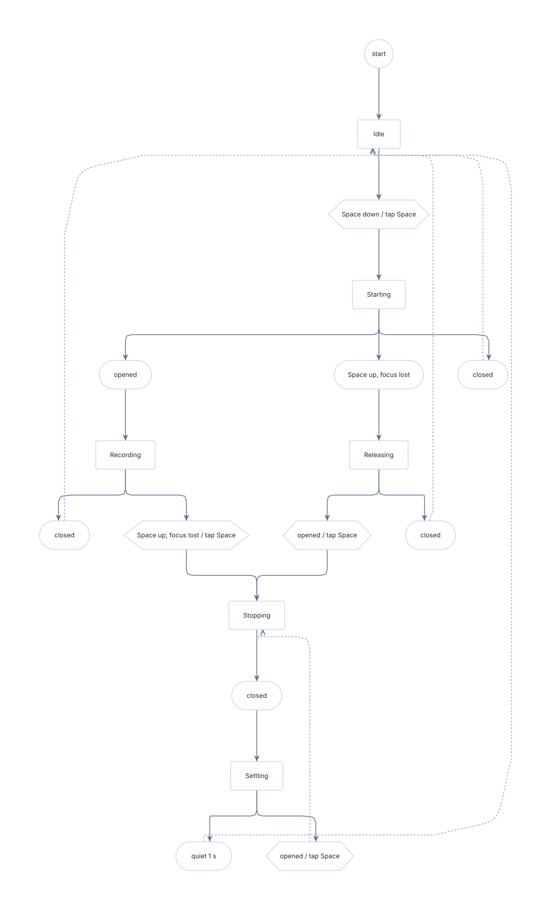

# Push-to-talk state machine

Generated from `step` in [`src/lib.rs`](src/lib.rs) by `cargo run -q` in `desktop/views/`, drawn with [frankenmermaid](https://github.com/Dicklesworthstone/frankenmermaid). States are rectangles; each transition is a node of its own (a hexagon when it taps Space), so the layout keeps every label clear; dashed edges are the ones the layout reversed to break cycles. Self-loops that change nothing are left out. The SVG is rendered with frankenmermaid's raster-safe settings (no CSS custom properties), so any SVG viewer draws it, not only browsers. `cargo test` in `desktop/views/` fails while these files differ from `step`; `cargo kani` in `talk/` proves the properties in `src/proofs.rs`.

Source: [`machine.mmd`](machine.mmd). Terminal rendering: [`machine.txt`](machine.txt).
